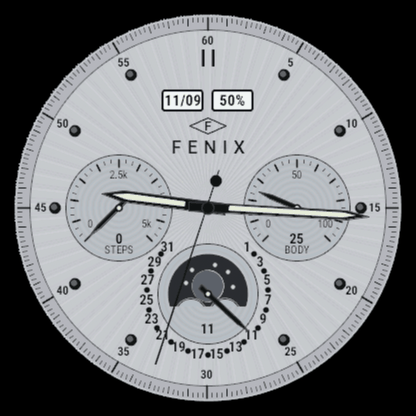
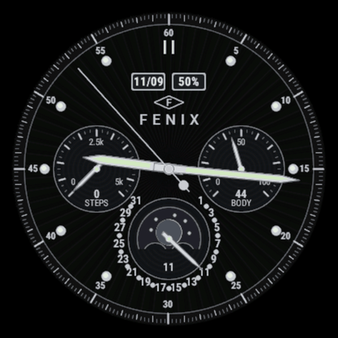
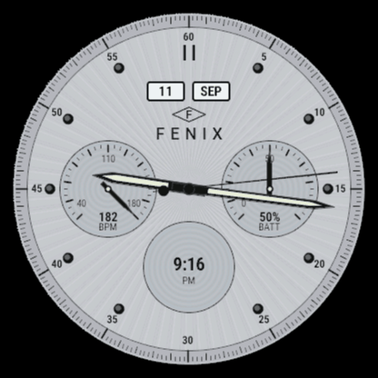

# Patek FENIX — luxury analog watch face for the Garmin fēnix 9 Pro 43mm

A black/silver perpetual-calendar-style analog face written in Monkey C for Connect IQ.
Sunburst-brushed dial, chapter ring with minute track, polished hour markers, luminous
dauphine hands, two calendar windows at 12, gauge sub-dials at 3 and 9, and a moon-phase
sub-dial at 6 with a 1–31 date track and pointer. Every complication slot is user-configurable.
A maker's mark sits under the windows: a hairline hallmark lozenge (a *poinçon*, the way
silver is struck) holding the initial F, over a letter-spaced FENIX — the owner's choice for his
own watch. No Patek branding, no diamonds: the dial artwork is original. ("Fēnix" is Garmin's
model name; keep this face for personal sideloading rather than a store listing.)

Primary target: `fenix9pro43mm` (416 × 416 AMOLED, Connect IQ API 6.0). Built and verified in
the Connect IQ 9.2.0 simulator; the same-panel `fenix943mm` and `fenix843mm` are in the manifest
and compile, but were not pixel-checked.

## Screenshots

Simulator captures on the fēnix 9 Pro 43mm (416 × 416).

<table>
  <tr>
    <td align="center"><br><sub>Light</sub></td>
    <td align="center"><br><sub>Dark</sub></td>
  </tr>
  <tr>
    <td align="center"><br><sub>Other fields</sub></td>
    <td align="center"><br><sub>Always-on</sub></td>
  </tr>
</table>

## Assumptions made during the autonomous build

These were decided without a chance to ask; each is a one-line change if you want it different.

1. **No system light/dark setting exists in Connect IQ.** Auto mode therefore follows
   sunrise/sunset from the watch's weather data when available, else a configurable day window
   (default 07:00–19:00). Manual Light / Dark override is a setting.
2. **All complication slots are configurable** (9 o'clock, 3 o'clock, 6 o'clock, and each 12 o'clock
   window on its own). Defaults: Steps, Body Battery, Moon + date track, 11/09 and battery %.
3. **Moon phase defaults to the southern hemisphere** (lit limb mirrored), since the wearer is in
   Australia. Setting: "Southern-hemisphere moon".
4. **Seconds hand shows only while the watch is awake.** AMOLED always-on mode updates once a
   minute and must light ≤10 % of pixels, so the low-power face is a black-ground outline face.
5. **Reference image**: the Patek Philippe photo attached to the request. No `image.png` was on
   disk; the layout was taken from the attached photo.
6. **Fonts**: the device's built-in Roboto Condensed faces via the vector-font API, so nothing
   third-party is bundled and there is no licence to carry.
7. Project location: `~/patek-fenix-watchface`. App name: "Patek FENIX" and dial word FENIX, both the owner's
   choice (the working name during the build was "Patek FENIX", French for silver). Not committed to git (no repo asked for).

## Files

```
manifest.xml                  app id, type=watchface, products, SensorHistory permission
monkey.jungle                 normal build      (source + source-release)
probe / dark / light / alt .jungle   screenshot builds (force AOD / dark / light palette / alternate slots)
resources/strings/strings.xml labels
resources/settings/properties.xml  the settings and their defaults
resources/settings/settings.xml    Connect IQ settings menu (lists, numeric, toggles)
resources/drawables/          launcher icon (SVG)
source/PatekFenixApp.mc           AppBase: initial view, onSettingsChanged
source/PatekFenixView.mc          WatchFace: update loop, buffers, awake/AOD paths, partial-update path
source/Dial.mc                Layout + Fonts + the static dial renderer (drawn once into a buffer);
                              the face is fully code-drawn, so there is no layout XML (same as the SDK's Analog sample)
source/Hands.mc               hand shapes, rotation into preallocated point arrays, lume drawing
source/Fields.mc              data-slot catalogue, sensor reads, formatting, per-slot readouts
source/Moon.mc                moon phase maths and disc rendering
source/Theme.mc               light/dark palettes and the auto-mode decision
source/Config.mc              typed settings snapshot
source/tests/PatekFenixTests.mc   unit tests (run in the simulator)
build.sh / run-sim.sh / run-tests.sh
evidence/                     simulator screenshots and the unit-test log
store/ + docs/store-listing.md   Connect IQ Store images and paste-ready listing copy
package.sh                    builds the store package (.iq)
```

## Settings (Connect IQ app settings, phone or Garmin Express)

| Setting | Values | Default |
|---|---|---|
| Colour mode | Auto / Light (silver) / Dark (black) | Auto |
| Auto follows sunrise/sunset | on/off | on |
| Day starts / Day ends (hour) | 0–23 | 7 / 19 |
| 9 o'clock sub-dial | Empty, Body Battery, Steps, Watch battery, Date, Digital time, Heart rate, Calories, Floors, Stress | Steps |
| 3 o'clock sub-dial | same list | Body Battery |
| 6 o'clock sub-dial | same list + Moon phase + date track | Moon + date |
| 12 o'clock window, left / right (independent) | Empty, Weekday (SAT), Month (SEP), Day (11), Day/Month (11/09), Month/Day (09/11), Watch battery %, Body Battery, Steps, Heart rate, Calories, Floors, Stress, Digital time | 11/09 and battery % |
| Southern-hemisphere moon | on/off | on |
| Seconds hand while awake | on/off | on |

Sub-dial gauges: 270° sweep, three scale labels. Body Battery / battery / stress are 0–100;
steps and floors run 0 → your daily goal; heart rate 40–180 bpm; calories 0–3000 kcal; date 1–31.
Each window shows one value of your choice; the 6 o'clock moon dial also prints the day number under the pointer.

## Build

Requirements: Connect IQ SDK (9.2.0 used), a device profile for `fenix9pro43mm` installed via the
SDK Manager, a Java runtime on PATH, and a developer key (`~/.connectiq/developer_key.der`).

```bash
cd ~/patek-fenix-watchface
./build.sh fenix9pro43mm release      # -> bin/patekfenix-fenix9pro43mm.prg (signed)
```

`build.sh` reads the SDK path from `~/Library/Application Support/Garmin/ConnectIQ/current-sdk.cfg`;
override with `CIQ_SDK=/path/to/sdk` and the key with `CIQ_KEY=/path/to/key.der`.
The underlying command is:

```bash
monkeyc -f monkey.jungle -d fenix9pro43mm -o bin/patekfenix-fenix9pro43mm.prg -y ~/.connectiq/developer_key.der -w -l 1 -r
```

Make a key once if you do not have one:

```bash
mkdir -p ~/.connectiq && cd ~/.connectiq
openssl genrsa -out developer_key.pem 4096
openssl pkcs8 -topk8 -inform PEM -outform DER -in developer_key.pem -out developer_key.der -nocrypt
```

## Run in the simulator

```bash
./run-sim.sh fenix9pro43mm release    # opens the simulator and loads the face
./run-sim.sh fenix9pro43mm dark       # dark palette, default slots
./run-sim.sh fenix9pro43mm light      # light palette, default slots (auto mode goes dark after the day window)
./run-sim.sh fenix9pro43mm alt        # light palette, heart rate / battery / digital / date windows
./run-sim.sh fenix9pro43mm probe      # the always-on (low-power) renderer
```

In the simulator use *Settings → Trigger App Settings* to edit the live settings, and
*Settings → Low Power Mode* to see the always-on face.

## Unit tests

```bash
./run-tests.sh fenix9pro43mm          # builds the -t variant and runs it in the simulator
```

Result on 2026-09-11: `PASSED (passed=10, failed=0, errors=0)` — see `evidence/unit-tests-fenix9pro43mm.txt`.
Covers moon-phase maths, number formatting, the auto-mode hour window, gauge/date angles,
the always-on offset rule, and the slot readouts.

## Connect IQ Store submission

```bash
./package.sh                          # -> bin/patekfenix-1.0.1.iq (all manifest products, signed)
python3 store/make-store-images.py    # -> store/*.png from evidence/store-*.png
```

Paste-ready copy and form answers: `docs/store-listing.md`. Images: `store/` (hero 1440 × 720,
cover 500 × 500, icon 128, four 416 × 416 screenshots; each under the store's 150 KB limit). The screenshots come from the `store-*`
builds (`./build.sh fenix9pro43mm store-light|store-dark|store-alt|store-aod`), which draw the dial
at 92 % so the simulator's bezel image hides none of it; every real build draws at 100 %.

## Sideload onto the watch

1. Build the release `.prg` (above).
2. Plug the watch in over USB and wait for it to mount as a drive.
3. Copy `bin/patekfenix-fenix9pro43mm.prg` into `GARMIN/APPS/` on the watch.
4. Eject, unplug. On the watch: hold **UP** → Watch Face → Patek FENIX (or long-press the face and pick it).
5. To change settings, use the Connect IQ app on the phone (Patek FENIX → Settings), or Garmin Express.

## How it draws (performance notes)

- **Static layer cached.** The dial (sunburst, chapter ring, markers, sub-dial faces and scales,
  window frames, moon aperture, date track) is rendered once into a full-screen `BufferedBitmap`
  in the graphics pool. It is re-rendered only when the palette, a slot choice or a daily goal
  changes (`ensureDial`). Each update is one bitmap blit plus the moving parts.
- **No per-frame allocation for geometry.** Hand polygons are preallocated arrays whose points
  are rewritten in place (`Hands.transform`). Readouts are reused objects.
- **Sensor reads are rate-limited.** Body Battery, steps, calories, floors, stress, battery and
  the date refresh once a minute; heart rate refreshes each update. Sunrise/sunset once a day.
- **AMOLED always-on.** When the device reports `requiresBurnInProtection` and the face is asleep,
  it draws a black ground, 2 px outline hands and twelve 2 px markers (≈1 % of pixels), and shifts
  the whole drawing through four offsets minute by minute so no pixel stays lit for more than one
  update cycle (the platform limit is three).
- **Partial updates** (`onPartialUpdate`, MIP devices without burn-in rules) are implemented with a
  second frame buffer and a clip region around the seconds hand; the `onPowerBudgetExceeded`
  callback disables them if the device objects. The fēnix 9 Pro 43mm is AMOLED and does not use
  this path.
- Anti-aliasing is on for hands and text; the buffer has no palette so AA works into it.

## Design notes

Geometry is defined at 416 px and scaled by `width / 416`. Centre (208, 208). Chapter ring 14 px
band with 60 minute ticks, 240 quarter ticks and 5…60 numerals at r=182. Hour markers: polished
dots at r=166 with a highlight, double baton at 12, none at 6 (the date track sits there).
Sub-dials: r=58 at (±100, 0), r=54 at (0, +94); azurage grooves every 3 px; gauge sweep 270°.
Windows: 46 × 24 px at y=92, ±27 px. Date track: r=66 about the 6 o'clock centre, day 1 at 40°
clockwise from 12, day 31 at 320°, odd numerals in radial text, dots for even days. Moon aperture:
r=42 disc cut flat at +14 px with two 16 px hills. Hands: hour 116 px, minute 176 px, seconds
180 px with a counterweight; lume inserts in pale green-white.

Maker's mark (`Dial.logo`): lozenge one window wide (46 × 22 px) with its tip in the notch between
the windows, the F set in the wordmark's own face (Roboto Medium, 14 px caps), FENIX measured glyph
by glyph, tracked 7 px and centred (caps at y 134–148). The lozenge-monogram form was chosen by a
five-concept, three-judge design panel (hallmark monogram > justified wordmark > lunar > elemental
> heraldic) on luxury taste, legibility at 326 ppi and originality; the word itself is the owner's.
To change the word, edit the `word` array and the initial in `Dial.logo`.

Fonts: Garmin's vector-font `:size` is the line box, not the cap height (caps ≈ 0.607 × size).
Sizes in `Fonts` are chosen for real cap heights: minute numerals 10 px, windows 11.5 px, gauge
labels 9 px, values 11 px, digital time 15 px, date track 8.5 px, mark 14 px.

Palettes (`source/Theme.mc`): light = silver `#C7CACF` face with `#141517` print and black hands
carrying ivory lume; dark = `#0B0B0C` face with `#C8CBD0` print and silver hands carrying pale
green lume. The moon sky is graphite in both modes with a silver moon.

## Known limits

- Auto colour mode by sunrise/sunset needs the phone-fed weather location; without it the hour
  window applies.
- Body Battery requires a device that records it (all listed products do) and the SensorHistory
  permission, already declared.
- Only English strings are provided.
